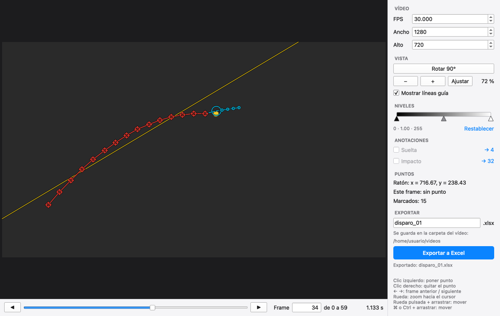

# Ballistiq

Marca a mano la posición de un objeto en cada frame de un vídeo y exporta a Excel
la tabla que asocia cada frame con sus coordenadas en píxeles. Funciona en macOS,
Windows y Linux, también en ordenadores ARM como la Raspberry Pi.



## Instalación

Solo necesitas [Python](https://www.python.org/downloads/) (de 3.8 a 3.14) y una
terminal. El instalador se encarga de todo lo demás:

```bash
git clone https://github.com/AstroEloy/ballistiq.git
cd ballistiq
python3 install.py
```

En Windows, la última línea es `py install.py` (o `python install.py`).

El instalador crea un entorno propio en `~/.ballistiq`, instala dentro las librerías
y deja listo el comando `ballistiq` (la primera vez, en una terminal nueva). No toca
nada de lo que ya tengas instalado. Si tu
Python no es de una versión admitida, busca otro compatible en tu equipo. En Linux, si
faltan el módulo `venv` de Python o las librerías gráficas del sistema, te ofrece
instalarlos.

| Para... | Ejecuta |
| --- | --- |
| Actualizar | `git pull` y de nuevo `python3 install.py` |
| Desinstalar | `python3 install.py --uninstall` |

## Uso

```bash
ballistiq              # pregunta qué vídeo abrir
ballistiq disparo.mp4  # abre ese vídeo
```

| Acción | Control |
| --- | --- |
| Poner el punto del frame (o moverlo) | Clic izquierdo |
| Quitar el punto del frame | Clic derecho |
| Frame anterior / siguiente | `←` `→` |
| Ir a cualquier frame | Barra inferior, o escribir el número |
| Zoom hacia el cursor | Rueda del ratón (botones `−` `+`: hacia el centro) |
| Mover la imagen | Arrastrar con la rueda pulsada, o con `Ctrl`, `⌘` o `Espacio` + clic izquierdo |
| Rotar 90° | Botón **Rotar 90°** |
| Ver mejor el objeto | Barra de **Niveles** (doble clic para restablecer) |

Cada frame admite un solo punto, y solo se edita el del frame en el que estás. Al
pasar de frame, el punto se hace más pequeño y queda fijo; si vuelves a su frame,
puedes cambiarlo. El zoom, la rotación y los niveles se mantienen al cambiar de frame.

**Trayectoria y predicción.** Los puntos se unen con líneas rectas en rojo y, en azul, se
dibuja dónde se espera el objeto en los 5 frames siguientes. La predicción es una recta
ajustada a los últimos 5 puntos y tiene en cuenta los frames que te hayas saltado.

**Recta de ajuste.** Al fondo, en amarillo, se dibuja de borde a borde de la imagen una
única recta ajustada a todos los puntos. Se calcula minimizando la distancia a la recta,
así que sirve para cualquier orientación de la trayectoria.

**Líneas guía.** La casilla *Mostrar líneas guía* oculta la línea roja, la recta de ajuste
y la predicción. Los puntos marcados se siguen viendo y lo que se exporta no cambia.

**Posición del ratón.** El panel muestra la `x` y la `y` del ratón con decimales, en las
mismas coordenadas que se exportan: el punto que marques ahí se exporta con ese valor.

**Suelta e impacto.** Marca el frame en el que se ve la suelta y el frame en el que se ve
el impacto. Son opcionales, porque un vídeo puede no mostrar la suelta, el impacto o
ninguno de los dos: en ese caso, deja esa casilla sin activar.

- Cada anotación se marca una sola vez y va sobre un frame que ya tenga punto.
- La suelta siempre va antes que el impacto.
- Puede haber puntos antes de la suelta y después del impacto.
- Si quitas el punto, se quita también su anotación.
- Para corregir una anotación, ve a su frame (el enlace `→` te lleva) y desmárcala.

**FPS, ancho y alto** se leen del vídeo, y se pueden cambiar si no son correctos. El
FPS afecta al tiempo mostrado. El ancho y el alto reescalan la imagen y las coordenadas
exportadas, lo que sirve para vídeos con píxeles no cuadrados. Si el vídeo tiene FPS
variable, la ventana te avisa.

## Qué se exporta

El botón **Exportar a Excel** guarda un `.xlsx` en la misma carpeta que el vídeo que
has abierto; la ventana te muestra cuál es. Hacen falta al menos 2 puntos. Por defecto
se llama como el vídeo, pero puedes escribir otro nombre. Si ya existe, pregunta antes
de reemplazarlo.

La hoja **Puntos** tiene una fila por punto:

| frame | pixel x | pixel y | anotación |
| --- | --- | --- | --- |
| 60 | 176.25 | 602.40 | suelta |
| 61 | 178.60 | 601.15 | |
| 62 | 180.85 | 600.05 | impacto |

La columna `anotación` queda en blanco en las demás filas. Si el vídeo no muestra la
suelta o el impacto, ninguna fila lleva esa palabra.

La hoja **Info** guarda los datos de la medida: vídeo, FPS, ancho, alto, rotación y los
frames de suelta e impacto.

Cómo leer los valores:

- Los frames se numeran **desde 0**.
- Las coordenadas son **píxeles con dos decimales**, con origen en la esquina superior
  izquierda y la `y` hacia abajo. El píxel `n` va de `n` a `n + 1`, así que su centro es
  `n + 0.5`.
- Corresponden al vídeo **tal como se ve**: dependen de la rotación y del ancho y alto
  indicados. Los niveles no les afectan, porque solo cambian cómo se ve la imagen.

## Compatibilidad

El instalador elige solo las versiones de las librerías que existen para tu sistema.

| Sistema | Desde | Python |
| --- | --- | --- |
| Windows x64 | Windows 10 | 3.8 a 3.14 |
| Windows ARM | Windows 11 | 3.11 a 3.14 (con Python 3.8 a 3.10, usa la versión x64 de Python) |
| Linux x86_64 | Ubuntu 20.04, Debian 10, RHEL 8 | 3.8 a 3.14 |
| Linux ARM de 64 bits | Raspberry Pi OS de 64 bits, Ubuntu 20.04, Debian 10 | 3.8 a 3.14 |
| macOS, Apple Silicon | macOS 11 | 3.8 a 3.14 (hasta 3.13 en macOS 11 y 12) |
| macOS, Intel | macOS 10.15 | 3.8 a 3.14 (hasta 3.13 en macOS 10.15) |

El máximo de cada librería en [`pyproject.toml`](pyproject.toml) es la última versión
probada, de modo que una versión nueva no puede romper una instalación.

### Otras plataformas

Para sistemas sin paquetes listos, como la Raspberry Pi con sistema de 32 bits, Ballistiq
puede usar las librerías de la propia distribución, sin instalador. En Debian, Ubuntu o
Raspberry Pi OS:

```bash
sudo apt install python3-pyqt6 python3-av python3-numpy python3-openpyxl
python3 ballistiq.py
```

Si tu sistema no tiene `python3-pyqt6`, usa `python3-pyqt5`. Esta vía no se comprueba
automáticamente, y las versiones de `python3-av` anteriores a la 12.3 no están probadas.

## Desarrollo

```bash
python3 -m venv .venv
source .venv/bin/activate
pip install -e ".[test]"
pytest
```

Las pruebas usan la ventana real con clics y teclas simulados, sobre vídeos generados
al vuelo. GitHub Actions las ejecuta en Linux y Windows, en x86_64 y ARM, y en macOS, con
cada cambio de código y una vez al mes ([`ci.yml`](.github/workflows/ci.yml)).
